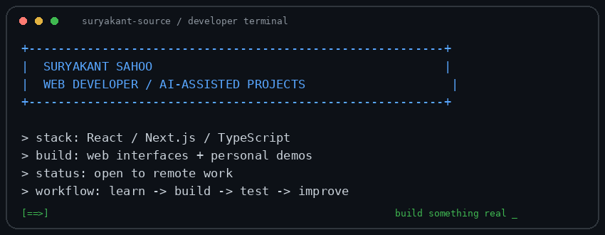

# Suryakant Sahoo

### Web developer · React, Next.js & TypeScript

[Portfolio](https://suryakant-sahoo-portfolio.netlify.app/) · [AI demos](https://suryakant16-portfolio.netlify.app/) · [LinkedIn](https://www.linkedin.com/in/suryakant-sahoo19/) · [Email](mailto:xbsuryakant@gmail.com)

## About

Web developer working with React, Next.js and TypeScript. I build web interfaces and explore AI-assisted development.

I'm open to remote web-development roles and freelance projects.

## Tools

I use AI coding tools in my workflow.

## Selected work

| Project | What it is |
| :--- | :--- |
| [PromptForge AI](https://github.com/suryakant-source/promptforge-ai) | A Next.js, React and TypeScript UI prototype for a prompt-writing product. Its demo uses preset examples, not live AI generation. |
| [Java programming](https://github.com/suryakant-source/JAVA-Programming) | A collection of Java practice code. |

## Portfolio demos

- [Web and UI demos](https://suryakant-sahoo-portfolio.netlify.app/)
- [AI and automation demos](https://suryakant16-portfolio.netlify.app/)

These are personal demos, not claims of paid client work.

## Contact

[LinkedIn](https://www.linkedin.com/in/suryakant-sahoo19/) · [Email](mailto:xbsuryakant@gmail.com)

## Contribution arcade

A snake animation drawn from my public GitHub contribution graph. It is a visualization, not an interactive game or a separate contribution score.

<picture>
  <source media="(prefers-color-scheme: dark)" srcset="github-snake-dark.svg" />
  <source media="(prefers-color-scheme: light)" srcset="github-snake.svg" />
  
</picture>

Updated daily from GitHub data. No synthetic activity or backdated commits.
