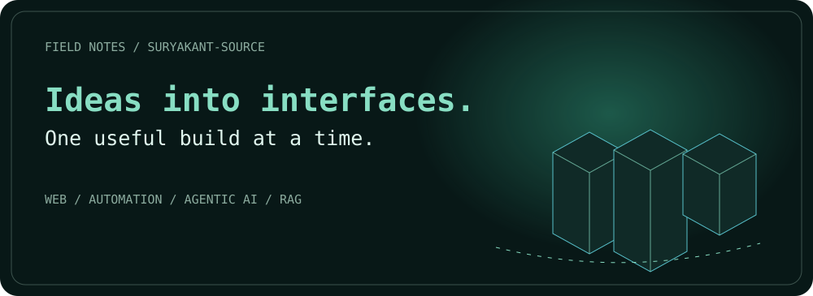
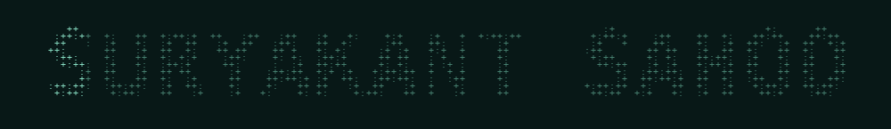
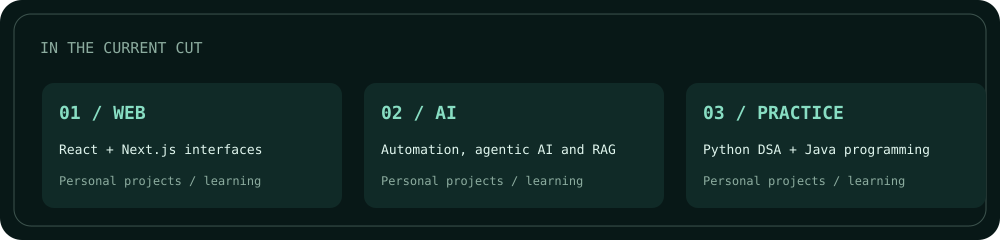
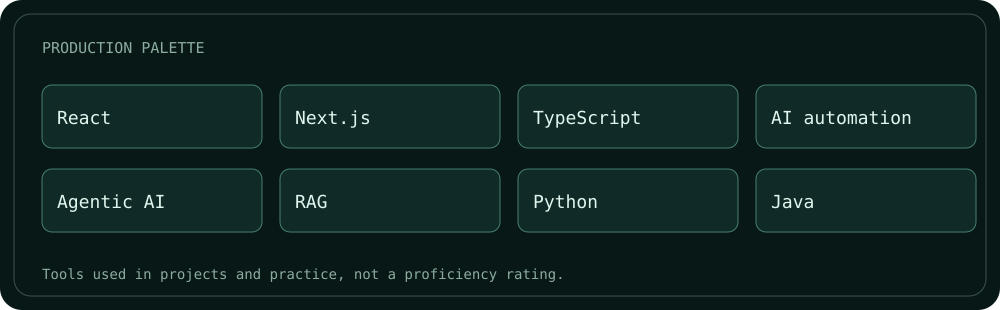
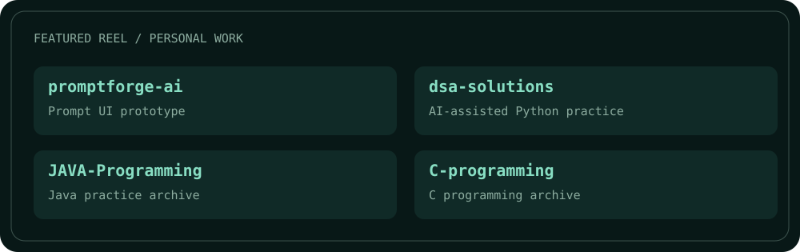
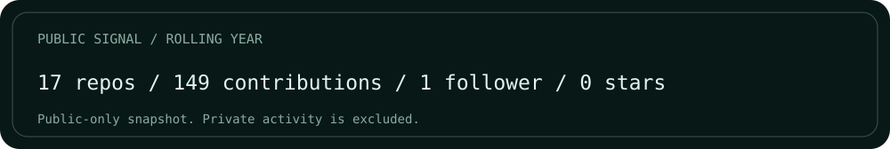
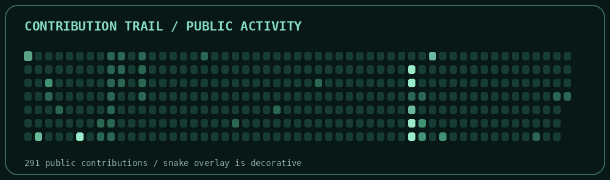
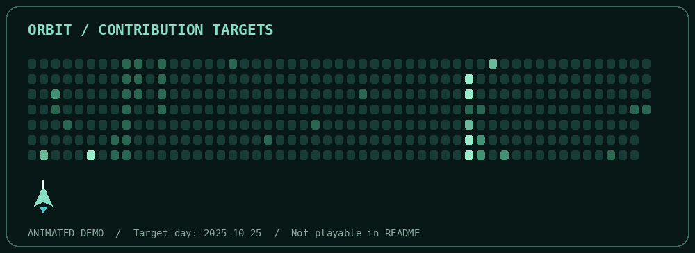

FIELD NOTES / SURYAKANT SAHOO

<picture><source media="(prefers-color-scheme: light)" srcset="assets-v3/2-hero-light.svg"></picture>

<strong>Web + AI developer</strong> · Bhubaneswar, India

Small steps. Honest work. Useful things.

<a href="https://suryakant-sahoo-portfolio.netlify.app/">Portfolio</a> · <a href="https://suryakant16-portfolio.netlify.app/">AI demos</a> · <a href="https://www.linkedin.com/in/suryakant-sahoo19/">LinkedIn</a> · <a href="mailto:xbsuryakant@gmail.com">Email</a>

─────── ◇ ───────

<table width="100%"><tr><td width="58%" valign="top"><h2>The point of view</h2><blockquote>Small steps. Honest work. Useful things.</blockquote>
I build web interfaces, AI automations, agentic AI and RAG projects. I use AI coding tools and keep learning through practice.

Open to remote roles and freelance projects.
</td><td width="42%" valign="top"><code>PROFILE</code>
ROLE · Web + AI developer BASED · Bhubaneswar, India FOCUS · Automation / Agentic AI / RAG

15 public repos 291 public contributions 1 follower
</td></tr></table>

─────── ◇ ───────

<h2>In the current cut</h2>
<picture><source media="(prefers-color-scheme: light)" srcset="assets-v3/4-highlights-light.svg"></picture>

─────── ◇ ───────

<h2>Production palette</h2>
<picture><source media="(prefers-color-scheme: light)" srcset="assets-v3/9-stack-light.svg"></picture>

─────── ◇ ───────

<h2>Featured reel</h2>
<picture><source media="(prefers-color-scheme: light)" srcset="assets-v3/6-projects-light.svg"></picture>
<table width="100%"><tr><td width="25%" valign="top"><strong><a href="https://github.com/suryakant-source/promptforge-ai">promptforge-ai</a></strong>
Next.js prompt UI prototype. Preset demo, not live generation.
TypeScript</td><td width="25%" valign="top"><strong><a href="https://github.com/suryakant-source/dsa-solutions">dsa-solutions</a></strong>
AI-assisted LeetCode and Codeforces Python archive.
Python</td><td width="25%" valign="top"><strong><a href="https://github.com/suryakant-source/JAVA-Programming">JAVA-Programming</a></strong>
Java programming practice.
Java</td><td width="25%" valign="top"><strong><a href="https://github.com/suryakant-source/C-programming">C-programming</a></strong>
C programming practice.
C</td></tr></table>

Personal demos and practice, not paid client-work claims.

─────── ◇ ───────

<picture><source media="(prefers-color-scheme: light)" srcset="assets-v3/11-stats-light.svg"></picture>

─────── ◇ ───────

<h2>Contribution trail</h2>

Real public day levels; snake is a decorative overlay. Private activity is excluded.

<h2>Play the next move</h2>

Original auto-playing animated demo, not an interactive game. Targets use real public contribution day levels. The animation does not change GitHub activity.

─────── ◇ ───────

THE NEXT SCENE<h2>Keep the story moving</h2>
Have an idea for a useful website or automation? Get in touch.

<a href="https://suryakant-sahoo-portfolio.netlify.app/">Portfolio</a> · <a href="https://suryakant16-portfolio.netlify.app/">AI demos</a> · <a href="https://www.linkedin.com/in/suryakant-sahoo19/">LinkedIn</a> · <a href="mailto:xbsuryakant@gmail.com">Email</a>

Original self-hosted profile assets. Public snapshots refresh daily only when data changes.

