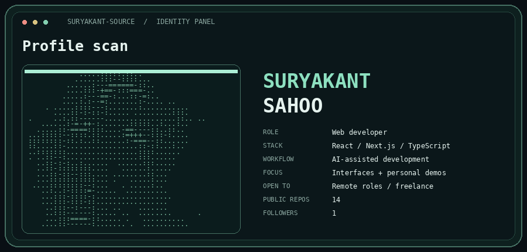
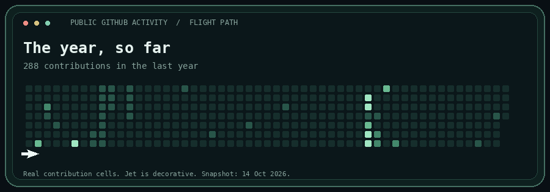
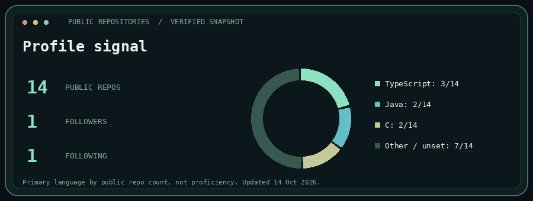

# Suryakant Sahoo

Web developer building AI automations, agentic AI and RAG projects. I work with React, Next.js and TypeScript, and use AI coding tools in my workflow.

Open to remote web-development roles and freelance projects.

[Portfolio](https://suryakant-sahoo-portfolio.netlify.app/) · [AI demos](https://suryakant16-portfolio.netlify.app/) · [LinkedIn](https://www.linkedin.com/in/suryakant-sahoo19/) · [Email](mailto:xbsuryakant@gmail.com)

## Selected work

- [PromptForge AI](https://github.com/suryakant-source/promptforge-ai): a Next.js, React and TypeScript UI prototype for a prompt-writing product. Its demo uses preset examples, not live AI generation.
- [Java programming](https://github.com/suryakant-source/JAVA-Programming): a collection of Java practice code.

[Web and UI demos](https://suryakant-sahoo-portfolio.netlify.app/) · [AI and automation demos](https://suryakant16-portfolio.netlify.app/)

These are personal demos, not claims of paid client work.

## The year, so far

The jet is a visual animation over real public contribution cells, not a playable game. Public-only numbers may differ from my signed-in contribution count.

## Profile signal

Primary-language share measures public repository count, not proficiency. Snapshots refresh daily when the underlying public data changes. No synthetic activity or backdated commits.
